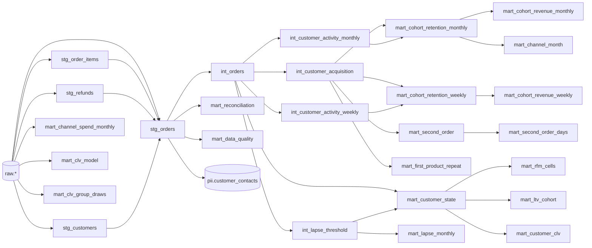

# Data model

Three schemas, each with one owner. Nothing writes outside its own schema.

| Schema | Owner | Written by | Read by |
|---|---|---|---|
| `raw` | `pipeline_rw` | ingest adapters, CLV fit | dbt |
| `analytics` (+ `analytics_build`) | `pipeline_rw` | dbt, swapped in by the worker | API (`api_ro`) |
| `pii` (+ `pii_build`) | `pipeline_rw` | dbt | only `ops.customer_contacts()` |
| `ops` | `migrator` (Alembic) | worker, API admin routes (`api_ops`) | API, worker |
| `auth` | `migrator` (Alembic) | web (Auth.js, `web_auth`) | web |

## raw

Every row keeps the full source payload. Upsert rule: insert, or update only when the incoming
`source_updated_at` is newer, so re-running a batch is a no-op.

```mermaid
erDiagram
  raw_orders ||--o{ raw_order_items : "payload.order_id"
  raw_orders ||--o{ raw_refunds : "payload.order_id"
  raw_customers ||--o{ raw_orders : "payload.customer_id"
  raw_orders { text source PK; text source_id PK; jsonb payload; timestamptz source_updated_at; uuid _batch_id }
  raw_order_items { text source PK; text source_id PK; jsonb payload }
  raw_refunds { text source PK; text source_id PK; jsonb payload }
  raw_customers { text source PK; text source_id PK; jsonb payload }
  raw_marketing_spend { date date PK; text channel PK; numeric spend_amount; text currency }
  raw_fx_rates { date date PK; text base PK; text quote PK; numeric rate }
  raw_clv_runs ||--o{ raw_clv_predictions : model_version
  raw_clv_runs ||--o{ raw_clv_holdout : model_version
  raw_clv_runs ||--o{ raw_clv_group_draws : model_version
  raw_clv_runs { text model_version PK; date cutoff_date; numeric holdout_mape }
  raw_clv_predictions { text model_version PK; text customer_key PK; numeric p_alive; numeric pred_ltv_12m_p10; numeric pred_ltv_12m_p50; numeric pred_ltv_12m_p90 }
  raw_clv_holdout { text model_version PK; date cohort_month PK; numeric predicted_revenue; numeric actual_revenue }
  raw_clv_group_draws { text model_version PK; text acquisition_channel PK; date cohort_month PK; int customers; float8_array draw_sums }
```

Payload shapes: `canonical` (csv, Online Retail II, Olist; adapters map files into it),
`shopify` (GraphQL Admin API nodes) and `woocommerce` (REST v3 objects). Only
`macros/normalize_sources.sql` knows them.

## analytics (dbt)



Grain of the main marts:

| Mart | Grain | Notes |
|---|---|---|
| `mart_cohort_retention_monthly` | cohort_month × channel × country × first_category × period | observable periods only; additive |
| `mart_cohort_retention_weekly` | cohort_week × dims × period | ISO weeks |
| `mart_cohort_revenue_monthly/weekly` | as above | net revenue per cell |
| `mart_second_order` / `_days` | customer / days × dims | histogram is additive |
| `mart_first_product_repeat` | level × item × cohort_month × dims | 90-day eligibility |
| `mart_customer_state` | customer | RFM, lapse, fixed-age LTV |
| `mart_rfm_cells` | R × F × cohort_month × dims | additive |
| `mart_ltv_cohort` | cohort_month × dims | eligible counts and sums |
| `mart_lapse_monthly` | month end × dims | lapse rate history |
| `mart_channel_month` | channel × cohort_month × period | CAC and payback inputs |
| `mart_channel_spend_monthly` | channel × month | reporting currency |
| `mart_customer_clv` | customer | latest model only |
| `mart_clv_group_draws` | channel × cohort_month | per-draw sums for group ranges |
| `mart_reconciliation` | day | source vs mart revenue |
| `mart_data_quality` | one row | Data page facts |

## ops (Alembic)

```mermaid
erDiagram
  jobs ||--o{ pipeline_runs : job_id
  pipeline_runs ||--o| data_versions : run_id
  jobs ||--o{ exports : job_id
  exports ||--o| export_files : export_id
  users { text email PK; text role; bool disabled; timestamptz last_seen_at }
  settings { text key PK; jsonb value; text updated_by }
  jobs { bigint id PK; text kind; jsonb payload; text status; timestamptz scheduled_for; int attempts }
  pipeline_runs { bigint id PK; text kind; text status; jsonb steps; jsonb tests; jsonb reconciliation; text data_version }
  data_versions { text version PK; bigint run_id; date data_through; timestamptz published_at }
  ingest_cursors { text source PK; text entity PK; text cursor_value }
  ingest_batches { uuid batch_id PK; text source; text entity; int rows_in; int rows_dropped; jsonb drop_reasons }
  audit_log { bigint id PK; text actor; text action; jsonb detail }
  exports { uuid id PK; text owner; text view; text status; text storage_key }
  export_files { uuid export_id PK; bytea content }
```

`ops.jobs` has a unique key on `(kind, scheduled_for)`; `ops.customer_contacts(keys, reveal)`
is a security-definer function owned by `pipeline_rw` that masks emails unless `reveal`.
